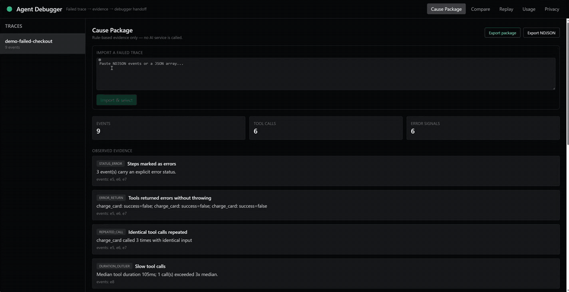

<p align="center">
  
</p>

<h1 align="center">Agent Debugger</h1>

<p align="center">
  <em>Failed agent trace → evidence → reproduction → debugger handoff.</em>
</p>

<p align="center">
  
  
  
</p>



Agent Debugger is a local-first developer tool for investigating **failed** agent runs. It does not try to replace observability platforms such as Langfuse, Phoenix, or LangSmith. Instead, it takes a trace you already have and builds a **Cause Package**:

- **Observed evidence** — directly visible facts with event IDs
- **Cause candidates** — rule-based hypotheses, each with a falsifier
- **Reproduction steps** — what to replay and what to compare
- **Next debugger action** — where to stop and what to inspect in your existing debugger

Everything runs on your machine. No account, no cloud, no external AI service.

## What this is / is not

| This build | Not included |
|---|---|
| Versioned event schema (`schemaVersion: 2`) | Live pause / inject |
| NDJSON / JSON trace import | Evals, datasets, scores |
| File-backed local event store | Cloud sync or accounts |
| Deterministic, rule-only Cause Package | External AI explanations |
| Portable redacted Cause Package bundles | Custom DAP/debugger implementation |
| Case comparison across two local traces | Cloud case storage |
| Browser-based local desktop shell | Native Electron/Tauri binary |

Cause candidates are **hypotheses derived from rules**, not verified root causes. The UI keeps observed facts, rule flags, hypotheses, reproduction steps, and handoff suggestions in separate sections.

## Why another debugger?

Most agent observability tools answer *what happened*. Agent Debugger answers the narrower question a developer has when a run fails: **what should I inspect next, and how can I prove that hypothesis wrong?**

- Evidence is separated from interpretation. A rule flag never becomes a root cause on its own.
- Every cause candidate carries a falsifier, so a hypothesis can be challenged instead of trusted.
- The handoff step points at your existing debugger and source location. This project does not invent another debug protocol.
- Privacy is structural: redaction runs on ingest, stream, export, and bundle creation, and usage data is allowlist-sanitized before it reaches disk.
- The scope is intentionally narrow: one failed run, compared against another when useful, then handed off.

If you need dashboards, evaluation suites, or team-wide trace retention, use an observability platform. Agent Debugger is the local step you take before or after that platform.

## Quick start

```bash
git clone https://github.com/woxlo1/agent-debugger.git
cd agent-debugger
npm install
npm run dev
```

This starts:

- the local API on `http://127.0.0.1:4317`
- the Web UI on `http://localhost:5173`

Open `http://localhost:5173`. The **Cause Package** view is selected by default.

For a one-command app-style launch, use the browser-based desktop shell instead:

```bash
npm run desktop
```

It starts the local API and serves the built UI from one loopback origin, then opens your default browser. See `docs/DESKTOP_SHELL.md`.

### Try the demo

In a second terminal while `npm run dev` is running:

```bash
npm run demo
```

The demo emits a fake failed checkout trace. Select it in the trace list and inspect its Cause Package, or switch to the **Replay** tab for the original timeline view.

A checked-in version of the same failure is available at `docs/examples/failed-trace.ndjson` for repeatable procedure checks. It is synthetic and contains no real customer data.

## Import an existing trace

```bash
# NDJSON / JSON Lines
agent-debugger import failed-run.jsonl

# From stdin
cat failed-run.jsonl | agent-debugger import

# Print the Cause Package as JSON
agent-debugger analyze <traceId>

# Print the AI usage ledger and privacy audit
agent-debugger usage <traceId>
agent-debugger privacy <traceId>

# Export a redacted portable Cause Package
agent-debugger package <traceId> failed-run.cause.json

# Compare two local traces
agent-debugger compare <traceIdA> <traceIdB>
```

You can also paste NDJSON into the **Cause Package** view and click **Import & select**.

Imported records are normalized into the v2 schema. Timestamps, status fields, error payloads, source locations, and token/cost fields are preserved when present. Secret-like keys, API-key patterns, bearer tokens, and email addresses are redacted on ingest and again on export.

## AI usage and privacy audit

AI usage is normalized from caller-supplied provider responses or explicit events. Values are labelled `reported`, `estimated`, or `unknown`; local estimates are excluded from billing totals unless you opt in with `--include-estimates` or the **Include estimates** checkbox.

```bash
# Normalize an OpenAI-style response already held by your agent
curl -X POST http://127.0.0.1:4317/api/usage \
  -H 'content-type: application/json' \
  -d '{"source":"openai_api","traceId":"run-1","payload":{"id":"chatcmpl-1","model":"gpt-5.6","usage":{"prompt_tokens":100,"completion_tokens":20}}}'
```

Claude Code and claude.ai Web sources require explicit consent before their values are included in totals. Redaction receipts store detector counts only, never raw values. See `docs/AI_SOURCE_MATRIX.md` for the full source policy.

## Case comparison and portable bundles

The **Compare** tab diffs two traces by metrics, observed evidence, cause hypotheses, unknowns, usage totals, confidence labels, and redaction findings. It is deterministic and local-only.

A **Cause Package** bundle is a single JSON file containing redacted events, rule-based analysis, the usage ledger, the privacy audit, provenance, and a SHA-256 fingerprint. Use it to hand a run to a debugger or teammate without sending raw prompts or transcripts.

```bash
curl http://127.0.0.1:4317/api/traces/<traceId>/package > failed-run.cause.json
curl 'http://127.0.0.1:4317/api/cases/compare?a=<traceIdA>&b=<traceIdB>'
```

See `docs/CASE_COMPARE.md` for the bundle contract and comparison rules.

## Local MCP server and Claude adapter

A local MCP server exposes the debugger over stdio JSON-RPC:

```bash
npm run mcp
```

It offers tools for listing traces, analyzing a trace, exporting a Cause Package, comparing traces, reading usage and privacy audits, importing events, and recording caller-supplied provider usage. It opens no port and calls no external service. See `docs/MCP_CLAUDE_LOCAL.md` for the client configuration and tool contract.

Claude Code local transcript reading is **off by default**. It requires the process switch `AGENT_DEBUGGER_CLAUDE_LOCAL=enabled`, explicit per-request consent, an absolute path allowlist, and strict redaction before normalization. The adapter returns count-only usage and never returns transcript text or file paths. claude.ai Web remains manual-export only.

## Instrumenting your own agent

The SDK is not published to npm yet. Use it from the workspace or send JSON Lines with the `pipe` command.

```ts
import { setTraceId, trace } from "./packages/sdk/src/index.ts"

setTraceId("checkout-agent-run-42")

await trace({
  type: "tool",
  name: "charge_card",
  input: { amount: 4200, currency: "JPY" },
  output: { success: false, error: "declined" },
  status: "error",
  source: { path: "src/tools/payments.ts", line: 88 },
})
```

`trace()` never throws; it returns `{ ok, event, error }`. Use `traceOrThrow()` when delivery failure must stop the run.

```ts
import { traceOrThrow } from "./packages/sdk/src/index.ts"

await traceOrThrow({ type: "agent", name: "final_answer", output: "..." })
```

### Any language via JSON Lines

```bash
# stdin
python3 your_agent.py | agent-debugger pipe

# file
agent-debugger pipe trace.jsonl

# explicit trace id
AGENT_DEBUGGER_TRACE_ID=run-42 agent-debugger pipe trace.jsonl
```

Minimum event:

```json
{"type":"tool","name":"search","input":"cats","output":"..."}
```

Optional v2 fields:

```json
{
  "type": "tool",
  "name": "search",
  "traceId": "run-42",
  "parentId": "step-7",
  "status": "error",
  "error": { "message": "timeout" },
  "source": { "path": "src/search.ts", "line": 31 },
  "durationMs": 5200,
  "attributes": { "retry_count": 3 }
}
```

Invalid lines are reported by line number only; raw line content is never logged.

## Event schema (v2)

```ts
type AgentEvent = {
  schemaVersion: number
  id: string
  traceId: string
  parentId?: string
  type: "user" | "agent" | "tool" | "reasoning" | "system"
  name: string
  status?: "ok" | "error" | "unknown"
  error?: { kind?: string; message?: string }
  input?: unknown
  output?: unknown
  timestamp: number
  durationMs?: number
  tokens?: number
  cost?: number
  source?: { path?: string; line?: number; symbol?: string }
  attributes?: Record<string, unknown>
}
```

## API

| Method | Path | Description |
|---|---|---|
| GET | `/api/health` | Health, schema version, store path |
| POST | `/api/events` | Submit one v2 event |
| POST | `/api/import` | Import `{ content, format?, traceId? }` or `{ events }` |
| GET | `/api/traces` | List trace summaries |
| GET | `/api/events?traceId=...` | List events |
| GET | `/api/traces/:traceId/analysis` | Build the rule-based Cause Package |
| GET | `/api/traces/:traceId/package` | Export a redacted portable Cause Package |
| GET | `/api/cases/compare?a=...&b=...` | Compare two local traces |
| POST | `/api/usage` | Normalize and store AI usage entries |
| GET | `/api/traces/:traceId/usage` | Build the consent-aware usage ledger |
| GET | `/api/traces/:traceId/privacy` | Aggregate redaction receipts and consent states |
| GET | `/api/traces/:traceId/export` | Download redacted NDJSON |
| POST | `/api/reset` | Clear the local store |
| GET | `/api/stream` | SSE stream of new events |

## Local security

- The server binds to `127.0.0.1` by default.
- CORS allows only `http://localhost:5173` and `http://127.0.0.1:5173` by default.
- Set `AGENT_DEBUGGER_ALLOWED_ORIGINS` to override the browser-origin allowlist.
- Set `AGENT_DEBUGGER_TOKEN` to require `x-agent-debugger-token` on all mutating APIs.
- Events are stored in `.agent-debugger/events.ndjson` by default; override with `AGENT_DEBUGGER_STORE`.
- Redaction is applied on import, event submission, SSE output, NDJSON export, and portable Cause Package export.
- Portable bundles carry counts and placeholders only; they never include a store path or raw usage payload.

For the threat model, findings, residual risks, and CI evidence, see `docs/SECURITY_REVIEW.md`. It is a pre-release review, not an audit or production-hardening claim.

## Rules currently implemented

The analyzer emits evidence for:

- explicit `status: "error"` or `error` payloads
- tool results containing `isError`, `success: false`, or an `error` field
- identical tool calls repeated three or more times
- tool calls without a captured output
- the last known good event before the first failure
- tool durations exceeding three times the median
- runs ending on a reasoning step without a final answer

Each candidate includes a falsifier so it can be challenged rather than trusted.

## Architecture

```
Your agent
   │  trace() / JSON Lines
   ▼
agent-debugger server
   ├─ importer.ts      normalize + redact
   ├─ store.ts         local NDJSON persistence
   └─ analyzer.ts      rule-based Cause Package
   ▼
packages/artifact      portable redacted bundle + fingerprint
packages/cases         deterministic case comparison
packages/mcp           stdio JSON-RPC tools + Claude local adapter
   ▼
scripts/desktop.mjs    loopback shell + /api proxy
   ▼
agent-debugger web
   ├─ Cause Package view
   ├─ Compare view
   ├─ Usage / Privacy views
   └─ Replay view
```

## Monorepo layout

```
packages/
  shared/          Frozen usage, consent, and privacy contracts
  privacy/         Count-only redaction engine
  ingest/          AI source normalizers
  usage/           Consent-aware usage ledger
  artifact/        Portable Cause Package builder and verifier
  cases/           Case comparison logic
  mcp/             Local stdio MCP server and Claude local adapter
  server/          Fastify API, importer, analyzer, local store, CLI
  sdk/             TypeScript event client
  web/             React + Vite + Tailwind UI
  example-agent/   Demo trace emitter
scripts/
  desktop.mjs      Browser-based local desktop launcher
  build-docs.mjs   Static docs site generator
```

## Performance

A repeatable, dependency-free benchmark harness measures the local path against a deterministic synthetic 10,000-event trace:

```bash
npm run verify
npm run bench
```

Published results are in `docs/PERFORMANCE.md`; raw measurements are in `docs/benchmark-results.json`. The latest run met the import, analysis, package export, memory, and web bundle targets. Cold start to `/api/health` did **not** meet the 500 ms target because the first TypeScript transform through `tsx` dominates startup; the miss is recorded rather than hidden.

Targets assume a commodity laptop and no network access. Results are local measurements, not user-study evidence.

## v1.0.0 release status

Tag `v1.0.0` and the matching GitHub Release are created from this commit. The MIT license and all package names are unchanged.

- [x] Generated docs site from `docs/`
- [x] Local MCP server exposing analysis and package tools
- [x] Browser-based desktop shell around the local UI
- [x] Benchmark harness and published results against the targets above
- [x] Final security review documented with findings and residual risks
- [x] Final project structure frozen in `docs/PROJECT_STRUCTURE.md`
- [x] Explicit release approval, version bump, tag, and GitHub Release
- [ ] Real-user validation with consented traces and third-party ground truth (materials ready in `docs/VALIDATION_KIT.md`; study not executed)
- [ ] npm publish (approved; requires registry authentication, dry-run verified)

CI never performs a version bump, tag, release, publish, or Hacker News post. The owner approved these actions explicitly for v1.0.0. The final Hacker News text is in `docs/HN_LAUNCH_DRAFT.md`; posting requires an authenticated HN session.

## Verification

```bash
npm run verify
```

This runs the JavaScript syntax checks, TypeScript checks, tests, the web build, and the static docs site build. No dependency install is performed by this repository's scripts.

A browsable docs site is generated into `docs-site/` with `npm run build:docs`. Host that directory as static files or open `docs-site/index.html` locally.

See `docs/PRODUCT_BRIEF.md`, `docs/ARCHITECTURE.md`, `docs/PROJECT_STRUCTURE.md`, `docs/VALIDATION_PLAN.md`, `docs/VALIDATION_KIT.md`, `docs/SECURITY_REVIEW.md`, `docs/USAGE_PRIVACY.md`, `docs/CASE_COMPARE.md`, `docs/MCP_CLAUDE_LOCAL.md`, `docs/DESKTOP_SHELL.md`, and `docs/PERFORMANCE.md` for scope, design, final structure, validation status, security review, and current contracts. Brand assets are documented in `docs/assets/README.md`.

## License

MIT
